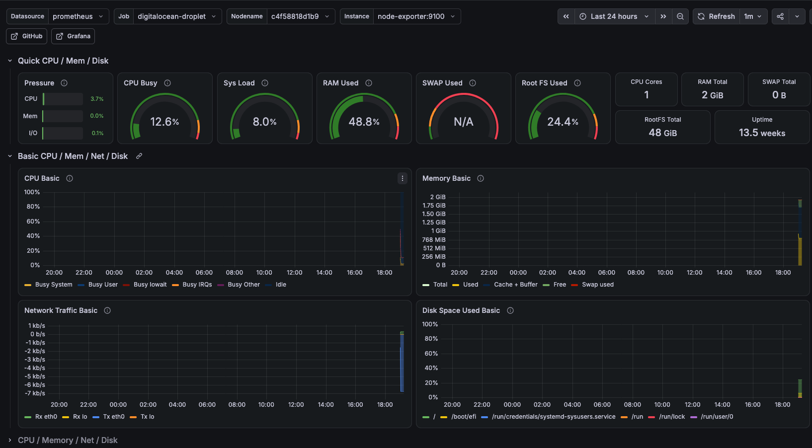
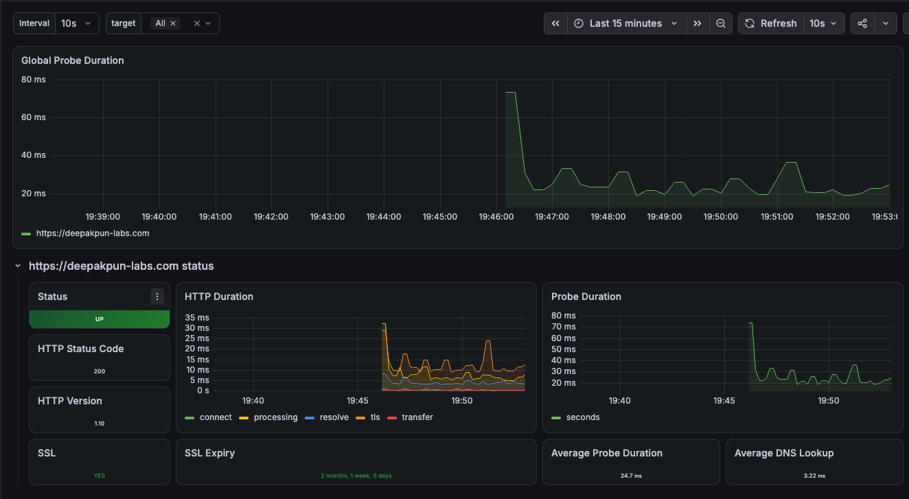

# 🌌 Deepak's MCU Multiverse Labs (`deepakpun-labs.com`)

A full-stack, containerized Marvel Cinematic Universe (MCU) intelligence registry and timeline tracker deployed on a DigitalOcean Ubuntu Droplet. Engineered with a production DevSecOps CI/CD pipeline, automated container vulnerability scanning, HTTPS reverse proxying, and full-stack observability.

**Live Production App:** [https://deepakpun-labs.com](https://deepakpun-labs.com)  
**REST API Health Check:** [https://deepakpun-labs.com](https://deepakpun-labs.com)

---

## 🛠️ Tech Stack

### Application Layer

- **Frontend (`services/client`):** Next.js, React, TypeScript
- **Backend API (`services/core-api`):** Node.js, Express.js
- **Database:** MongoDB (with persistent named volume storage and native health checks)

### Infrastructure, DevSecOps & Observability

- **Containerization & Orchestration:** Docker & Docker Compose (`compose.yaml`)
- **Reverse Proxy & TLS:** Nginx (`alpine-slim`) + Let's Encrypt / Certbot SSL
- **CI/CD & Security Gates:** GitHub Actions + Docker Hub + Aqua Trivy (`CRITICAL` & `HIGH` CVE scanning)
- **Metrics & Uptime Monitoring:** Prometheus + Node Exporter + Blackbox Exporter
- **Centralized Logging & Visualization:** Grafana Loki + Promtail + Grafana

---

## 🏗️ System Architecture

All application containers, databases, and telemetry collectors run inside an isolated Docker bridge network (`deepakpun-labs-network`). Only HTTP (`80`) and HTTPS (`443`) are exposed to the public internet via Nginx.

```text
                        ┌───────────────────────────────────────┐
                        │           Public Internet             │
                        └───────────────────┬───────────────────┘
                                            │ HTTPS (443)
                                            ▼
                        ┌───────────────────────────────────────┐
                        │    Nginx Reverse Proxy (SSL/TLS)      │
                        └───┬───────────────┬───────────────┬───┘
                  /         │         /api/ │      /grafana/│
                  ▼         │               ▼               ▼
        ┌───────────────────┐     ┌───────────────────┐   ┌───────────────────┐
        │   Next.js Client  │     │  Express Core API │   │      Grafana      │
        │   (TypeScript)    │     │   (REST + Health) │   │ (Unified Portal)  │
        └───────────────────┘     └─────────┬─────────┘   └────┬─────────┬────┘
                                            │                  │         │
                                            ▼          Metrics │         │ Logs
                                  ┌───────────────────┐        ▼         ▼
                                  │      MongoDB      │   ┌─────────┐ ┌─────────┐
                                  │  (mongo_data vol) │   │Prometheus│ │  Loki   │
                                  └───────────────────┘   └────┬────┘ └────▲────┘
                                                               │           │
                                            ┌──────────────────┴───┐       │
                                            ▼                      ▼       │
                                  ┌───────────────────┐  ┌───────────────┐ │
                                  │   Node Exporter   │  │   Blackbox    │ │
                                  │ (Droplet Vitals)  │  │ (HTTP/SSL 15s)│ │
                                  └───────────────────┘  └───────────────┘ │
                                                                           │
                                                         ┌─────────────────┴─┐
                                                         │     Promtail      │
                                                         │  (Docker Socket)  │
                                                         └───────────────────┘
```

---

## 🚀 CI/CD & DevSecOps Pipeline (`.github/workflows/deploy.yml`)

Every push to the `main` branch triggers a two-stage automated deployment workflow:

1. **Build, Push & Security Scan (`build-and-push`):**
   - Builds `linux/amd64` production images for both `portfolio-client` and `portfolio-core-api` and pushes immutable `sha-<commit>` and `latest` tags to Docker Hub.
   - Scans both built container images using **Aqua Trivy** (`os,library` vulnerability types, `CRITICAL,HIGH` severity) before deployment.
2. **Automated Production Rollout (`deploy-to-droplet`):**
   - Dynamically generates the production `.env` file from encrypted GitHub Actions Secrets (`PROD_ENV_FILE`).
   - Securely transfers `compose.yaml`, `nginx.conf`, `prometheus.yml`, `blackbox.yml`, `loki-config.yml`, `promtail-config.yml`, and deployment scripts to the DigitalOcean Droplet via SCP (`overwrite: true`).
   - Executes `./run.sh prod` over SSH (`script_stop: true`) to pull updated images, recreate changed services cleanly, prune stale images, and reload Nginx with zero manual intervention.

---

## 📊 Observability, Monitoring & Centralized Logging

The production Droplet includes a self-hosted observability stack accessible exclusively through an authenticated HTTPS subpath at `https://deepakpun-labs.com`.

| Service               | Image                           | Role & Configuration                                                                                                                                               |
| :-------------------- | :------------------------------ | :----------------------------------------------------------------------------------------------------------------------------------------------------------------- |
| **Prometheus**        | `prom/prometheus:latest`        | Scrapes server and application telemetry every 15 seconds with a 7-day TSDB retention window (`--storage.tsdb.retention.time=7d`).                                 |
| **Node Exporter**     | `prom/node-exporter:latest`     | Collects host-level Ubuntu Droplet metrics (CPU load, RAM usage, disk space, and network I/O) via read-only `/proc` and `/sys` mounts.                             |
| **Blackbox Exporter** | `prom/blackbox-exporter:latest` | Probes `https://deepakpun-labs.com` and `/health` every 15 seconds to verify HTTP `200 OK` status, measure response latency, and track SSL certificate expiration. |
| **Grafana Loki**      | `grafana/loki:3.0.0`            | Stores and indexes container logs using TSDB schema `v13` with an automated 7-day (`168h`) retention policy via the compactor.                                     |
| **Promtail**          | `grafana/promtail:3.0.0`        | Discovers active containers via `/var/run/docker.sock`, attaches container labels, and streams logs to Loki in real time.                                          |
| **Grafana**           | `grafana/grafana:latest`        | Unified dashboard and log exploration UI secured behind TLS, WebSocket proxying, and admin credentials.                                                            |

### Production Dashboards & Screenshots

- **Droplet Infrastructure (Dashboard `1860`):** Real-time CPU, memory, filesystem, and network monitoring.
- **Synthetic Uptime & SSL (Dashboard `7587`):** Live availability and latency tracking for frontend and API endpoints.
- **Live Log Exploration (Grafana Explore):** Real-time container log filtering (`{container="core-api"}`, `{container="nginx"}`) without SSH access.

> _Tip: Add your Grafana screenshots to `docs/images/` and uncomment the table below to display them directly on GitHub._

|              Droplet Hardware Metrics (Node Exporter)               |            Live Uptime & Latency (Blackbox Exporter)             |
| :-----------------------------------------------------------------: | :--------------------------------------------------------------: |
|  |  |

---

## 💻 Local Development & Operations (`run.sh`)

The repository includes a helper CLI script (`run.sh`) to manage both local development and production environments:

```bash
# Start local development stack with hot-reloading
./run.sh dev

# Pull latest production images and deploy in detached mode
./run.sh prod

# Gracefully stop all running containers
./run.sh stop

# Stop containers and prune unused Docker networks/images (preserves database volumes)
./run.sh clean
```

---

## 🔐 Environment Variables

Production secrets are injected at deploy time via GitHub Actions (`PROD_ENV_FILE`). For local development, create a `.env` file in the project root:

```env
MONGO_ROOT_USER=your_mongo_user
MONGO_ROOT_PASSWORD=your_strong_mongo_password
GRAFANA_ADMIN_USER=admin
GRAFANA_ADMIN_PASSWORD=your_strong_grafana_password
```
